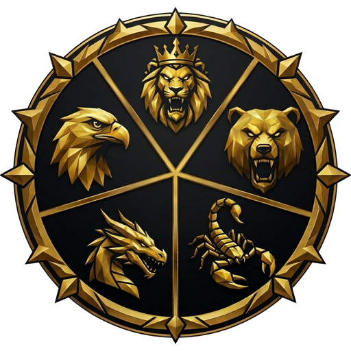
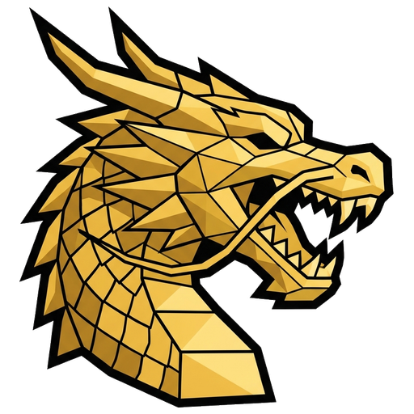

<p align="center">
  <a href="https://black-area.vercel.app"></a>
</p>

<h1 align="center">Black Area</h1>

<p align="center"><sub>Phiên bản 3.75.137 · Version 3.75.137</sub></p>

<p align="center"><b><a href="https://black-area.vercel.app">▶ CHƠI NGAY / PLAY NOW: black-area.vercel.app</a></b></p>

<p align="center"><a href="#tieng-viet">Tiếng Việt</a> · <a href="#english">English</a></p>

---

<a id="tieng-viet"></a>

## 🇻🇳 Tiếng Việt

> **Thế giới chỉ cần một kẻ viết luật. Năm kẻ đang tranh nhau cây bút.**

*Người ta bảo cuộc chiến này nổ ra vì dầu. Đó chỉ là cái cớ. Thứ họ thật sự muốn là quyền quyết định thế giới sẽ vận hành theo luật của ai, và nếu mình không thể làm chủ thì không ai được làm chủ cả.*

### I. Cái cớ

Năm 20XX, các giếng dầu lớn trên Trái Đất lần lượt cạn, và cả thế giới quay sang nhìn nhau: ai sẽ được chia phần, chia bao nhiêu, và ai có quyền quyết định cách chia. Nhưng những người ngồi trong các văn phòng kín ở Washington, Moscow, Bắc Kinh, Paris và Riyadh hiểu rằng dầu chỉ là câu hỏi nhỏ; câu hỏi lớn hơn là sau cơn khủng hoảng này, thế giới sẽ cần một người cầm trịch mới, và chiếc ghế ấy đang bỏ trống. Không ai chịu để kẻ khác ngồi vào đó: hễ một cường quốc vươn lên quá cao, những kẻ còn lại lập tức bắt tay nhau kéo nó xuống, bởi nếu mình không được làm chủ thì không ai được làm chủ cả. Thế giới cứ thế bị giữ ở một thế cân bằng mong manh, nơi không ai đứng một mình được và ai cũng phải phụ thuộc vào nhau, và chính thế cân bằng ấy là ngòi nổ của cuộc chiến.

### II. Ngày Liên Hợp Quốc sụp đổ

Người ta vẫn gọi đó là ngôi nhà chung của nhân loại, dù ai cũng biết chìa khóa của ngôi nhà ấy từ lâu đã nằm trong túi của vài vị chủ nhà quen thuộc: nghị quyết nào có lợi cho họ thì thông qua trong một buổi chiều, nghị quyết nào có lợi cho kẻ khác thì "cần thêm thời gian xem xét", lệnh trừng phạt luôn rơi trúng những nước không chịu nghe lời, còn lực lượng gìn giữ hòa bình thì kỳ lạ thay chỉ xuất hiện ở những nơi có dầu. Khi phiên họp khẩn cấp kéo dài mười chín ngày chỉ để những vị chủ nhà ấy một lần nữa viết luật theo cách của mình, những người khách còn lại lặng lẽ đứng dậy rời khỏi phòng, và Liên Hợp Quốc chết đi trong im lặng: cờ vẫn treo, loa vẫn bật, nhưng không còn ai tin những gì nó nói. Thế giới mất đi người trọng tài cuối cùng, và năm cường quốc nhận ra rằng từ nay, luật chơi sẽ thuộc về kẻ đủ mạnh để áp đặt nó.

### III. Những cái tên mới

Mỗi cái tên cũ là một sợi dây trói vào những hiệp ước đã ký và những lời hứa đã trao, nên các cường quốc lần lượt cắt đứt nó để bước vào thế giới mới không nợ ai, không cúi đầu trước ai. Washington không hỏi ý kiến bất kỳ ai, đơn phương tuyên bố với thế giới cái tên mới của mình: **Paxamerica**. Trên nóc điện Kremlin, lá cờ một lần nữa được kéo xuống như đã từng trong lịch sử, để một quốc gia mới mang tên **Nordursia** đứng lên từ băng tuyết. Bắc Kinh đã ngủ đủ lâu; khi thức dậy dưới cái tên **Longoria**, họ bắt đầu giấc mơ thống trị thế giới. Các quốc gia Hồi giáo gác lại mọi bất đồng để họp thành **Liên minh Lunastron**, liên minh tôn giáo đầu tiên của thế giới hiện đại. Chỉ có **Châu Âu** là không đổi: lục địa già vẫn giữ nguyên tên gọi, và cùng với nó là những giá trị mà họ tin rằng không cuộc chiến nào xóa được.

### IV. Năm cực, năm bộ luật

<p align="center">
  
  
  
  
  
</p>

Mỗi cường quốc mang theo một bản luật cho thế giới mới và chỉ chờ cơ hội để buộc tất cả những kẻ còn lại phải ký: **Paxamerica** muốn một thế giới mà mọi đồng tiền đều chảy qua tay họ, và họ đánh nhanh, đánh xa, đánh chính xác để chứng minh điều đó; **Nordursia** muốn một thế giới chia thành những vùng ảnh hưởng, nơi tiếng Tu-160 rền vang trên bầu trời là lời nhắc rằng sân nhà của họ rộng đến đâu; **Longoria** muốn một thế giới vận hành theo kế hoạch của họ, với thép dày, quân đông và những công xưởng không bao giờ ngủ; **Châu Âu** muốn một thế giới của luật lệ và thể chế, miễn là luật lệ ấy do họ soạn; còn **Liên minh Lunastron** nắm cartel dầu trong tay và biết rằng chỉ một lệnh cắt giảm hay xả kho là đủ khiến ngân khố đối thủ sụp đổ trong một đêm, nên dầu với họ không phải mục tiêu mà là vũ khí.

### V. Kẻ đứng giữa

Ở Zürich, Global Monitoring Center là định chế cuối cùng còn đứng ngoài cuộc chơi: nó mua dầu của tất cả với cùng một giá, cho vay khi ngân khố cạn và luôn thu nợ trước mọi khoản khác; nó không chọn phe, nó chỉ đứng nhìn, vì nó biết kẻ thắng cuối cùng rồi cũng sẽ cần một ngân hàng.

### VI. Những kẻ muốn đứng ngoài

Anh, Canada, Cuba, Nhật Bản, Úc, Brazil, Ấn Độ, Ukraine, Belarus và hai miền Triều Tiên tuyên bố trung lập, tin rằng không chọn phe thì sẽ không ai chọn mình, nhưng trong cuộc tranh giành ngôi đàn anh này, trung lập chỉ có nghĩa là *chưa bị chiếm*: một kỹ sư lặng lẽ bước qua cổng thủ đô lúc nửa đêm là sáng hôm sau cả một quốc gia đã trở thành đàn em của một phe, mang theo tiền bạc hay kho vũ khí riêng của nó, từ pháo K9 ở Seoul, laser LDEW ở London, dàn phóng BM-21 ở Bình Nhưỡng, Kyiv và Minsk, C-17 ở New Delhi đến A-29 ở Brasília, và rồi lại đổi chủ khi kẻ khác kéo đến.

### VII. Lục địa trắng

Dưới băng Nam Cực, năm giếng dầu vô chủ vẫn đang bơm; không ai được dựng dù chỉ một mái nhà trên lục địa ấy, nhưng ai cũng muốn cắm cờ lên đó, vì giữ được giếng dầu cuối cùng của Trái Đất là lời tuyên bố với cả thế giới rằng mình mới là kẻ đứng đầu.

### VIII. Người đứng cuối cùng

Dầu bán lấy tiền, tiền mua xe tăng, xe tăng giành thêm đất, thêm đồng minh, thêm tiếng nói, và vòng tròn ấy cứ quay. Chỉ khi có một kẻ phá vỡ được thế cân bằng và đứng vững tới cuối cùng, kẻ ấy mới có được thứ quý hơn dầu rất nhiều: quyền viết luật cho cả thế giới mới.

<p align="center"><b>Black Area. Cuộc chiến giành ngôi đàn anh của thế giới bắt đầu.</b></p>

### Chạy dự án

Dự án dùng **npm workspaces**: `ui/` và `server/` dùng chung một `node_modules` và một `package-lock.json` ở thư mục gốc. Chỉ cần cài một lần ở thư mục gốc:

```
npm install
npm run dev          # game (ui/, Vite)
npm run server:dev   # máy chủ phòng chơi (server/, cổng 8787 hoặc PORT)
```

| Thư mục | Nội dung |
|---|---|
| `ui/` | Game (Vite + TypeScript) |
| `server/` | Máy chủ phòng chơi nhiều người (Node + WebSocket) |

Thêm thư viện cho một phần: `npm install <gói> -w ui` hoặc `-w server`. Game kết nối máy chủ qua `VITE_GAME_SERVER_API` (ví dụ `https://black-area.onrender.com`; không đặt thì dùng `http://localhost:8787` khi dev và `https://black-area.onrender.com` khi build). Triển khai: máy chủ lên Render bằng `render.yaml`, game lên Vercel bằng `vercel.json`.

---

<a id="english"></a>

## 🇬🇧 English

> **There is only one world. And there is not enough oil for everyone.**

*They still say the war did not begin with a gunshot, but with a number on the oil price board.*

### I. The day the wells ran dry

In the year 20XX, on a morning like any other, engineers in Texas reported to Washington that the drill had hit bottom. That same week, the same news came from Western Siberia, from the Xinjiang desert, from the frozen rigs off Northern Europe. The Earth had given away almost everything it had.

The world turned to New York, as it always did in a crisis.

### II. The day the United Nations fell

The Security Council's emergency session lasted nineteen days. Washington proposed sharing oil by purchasing power. Moscow vetoed. Beijing proposed sharing by population. Washington vetoed. Paris demanded a common oil fund run by an international committee, and this time both sides vetoed. Riyadh proposed nothing. It simply reminded everyone whose ground the oil lay under.

By the twentieth day the chairs began to empty. One delegation went home "for consultations" and never came back; another stopped paying its dues. Nobody dissolved the United Nations. It just died quietly: a building by the East River, flags still flying, and no one left listening.

### III. The day the old names came down

The old names carried a whole history with them: treaties signed, promises given, seats in a building nobody listened to any more. Keeping an old name meant staying tied to the old rules, and having to explain to the world why you were breaking your own word. No one wanted to drag those ropes into a multipolar world where nobody stands above anybody.

So the great powers, who agreed on nothing, copied each other in exactly one thing: **erasing their own old names**. A new name is a blank page: it owes nothing, belongs to no bloc, and answers to no one.

Washington went first. In a ceremony lasting exactly thirteen minutes, the old flag came down in front of the White House and the spokesman read the new name: **Paxamerica**. The world's press laughed for a week. Then it stopped laughing when the B-1A Lancers rolled out in the new insignia.

Moscow would not be outdone. On a night of heavy snow, the Kremlin decreed the country's new name: **Nordursia**. Nobody dared ask why.

Beijing thought longer, as always. When it spoke, it chose a name as smooth as silk: **Longoria**.

Riyadh came last. It kept the one word it held more sacred than oil: *Union*. And it called itself the **Lunastron Union**.

Only Paris changed nothing. Europe stayed Europe. Real institutions, it said, need no new name to be respected. The others said Europe simply had not finished its meeting yet.

### IV. Five poles, five rulebooks

**Paxamerica** wants a world of free markets, where oil belongs to the highest bidder. It strikes fast, far and precisely.

**Nordursia** wants a world of spheres of influence. It trusts overwhelming firepower, and the roar of the Tu-160 over the northern sky is a reminder of how big that backyard is.

**Longoria** wants a world of order and planning. Its steel is thick, its armies are vast, and its factories never sleep.

**Europe** wants a world of rules and institutions, even though no one will sit at the table to write them any more. Balanced and enduring, ready for every front.

The **Lunastron Union** sits on the richest oil fields left and runs the oil cartel. One order to **cut**, and the oil price soars. One order to **flood**, and a rival's treasury collapses overnight.

### V. The one in the middle

In Zürich, among silent glass towers, the Global Monitoring Center counts money. It is the last buyer of oil, sets one price for everyone, lends when treasuries run dry, and always collects its debts first. It takes no side. It just waits patiently to see who goes bankrupt first.

### VI. Those who wanted to stay out

Britain, Canada, Cuba, Japan, Australia, Brazil, India, Ukraine, Belarus and both Koreas declared themselves neutral. They were wrong. In this war, neutral only means *not taken yet*. One engineer walking quietly through a capital's door is enough for a whole nation to change hands, bringing its military presence fee, or its own machines of war: Seoul's K9 howitzers, London's LDEW lasers, the BM-21 launchers of Pyongyang, Kyiv and Minsk, the C-17 airlifters of New Delhi.

### VII. The white continent

Under the Antarctic ice, five ownerless oil wells are still pumping. No one may raise even a single roof on that continent. A well belongs to the side of the last engineer who touched it, until someone else knocks it back to neutral and takes it.

### VIII. The last one standing

Oil is sold for money. Money buys tanks. Tanks guard the oil wells. And the circle keeps turning. Lose your capital and your army, and your nation vanishes from the map as if it had never existed.

Only the last one standing will decide what is left of the Earth.

<p align="center"><b>Black Area. The war for the Earth begins.</b></p>

### Running the project

The project uses **npm workspaces**: `ui/` and `server/` share one `node_modules` and one `package-lock.json` at the root. Install once at the root:

```
npm install
npm run dev          # the game (ui/, Vite)
npm run server:dev   # the room server (server/, port 8787 or PORT)
```

| Folder | Contents |
|---|---|
| `ui/` | The game (Vite + TypeScript) |
| `server/` | Multiplayer room server (Node + WebSocket) |

Add a library to one part: `npm install <package> -w ui` or `-w server`. The game reaches the server through `VITE_GAME_SERVER_API` (e.g. `https://black-area.onrender.com`; unset, it uses `http://localhost:8787` in dev and `https://black-area.onrender.com` in builds). Deployment: the server on Render via `render.yaml`, the game on Vercel via `vercel.json`.
