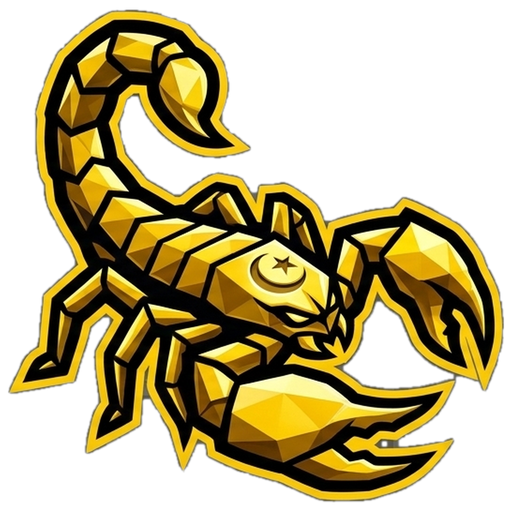

<p align="center">
  <a href="https://black-area.vercel.app"></a>
</p>

<h1 align="center">Black Area</h1>

<p align="center"><sub>Phiên bản 3.75.199 · Version 3.75.199</sub></p>

<p align="center"><b><a href="https://black-area.vercel.app">▶ CHƠI NGAY / PLAY NOW · black-area.vercel.app</a></b></p>

<p align="center"><a href="#tieng-viet">Tiếng Việt</a> · <a href="#english">English</a></p>

---

<a id="tieng-viet"></a>

## 🇻🇳 Tiếng Việt

<h2 align="center">Thế giới đa cực mới</h2>

<p align="center">
  
  
  
  
  
</p>

*Năm 20XX, giếng dầu lớn cuối cùng ngừng bơm. Liên Hợp Quốc triệu tập phiên họp khẩn kéo dài chín ngày, và khi kết thúc, thế giới cũ không còn nữa.*

#### Ngày 1

Khủng hoảng lan nhanh hơn mọi dự báo. Sáng nay, thêm ba thủ đô mất điện. Giá dầu nhảy mỗi giờ một mức. Biểu tình nổ ra ở hàng chục thành phố, biên giới đóng lại, và những chuyến tàu chở hàng nằm im ngoài cảng. Mỗi bản tin buổi tối lại tệ hơn bản tin buổi sáng.

#### Ngày 2

Tổng thư ký đứng trước Đại hội đồng và đọc lời kêu gọi. Mọi quốc gia phải **hoàn thành trách nhiệm và nghĩa vụ của mình đối với thế giới**. Quốc gia còn dầu phải chia sẻ. Quốc gia còn tiền phải góp quỹ cứu trợ. Quốc gia còn quân phải gửi lính tới những nơi đang bốc cháy. Hạn chót là ngày thứ chín.

#### Ngày 5

Tối hôm đó, quốc hội ở Washington, Moscow, Bắc Kinh, các nước châu Âu và các nước Hồi giáo cùng họp khẩn.

Ngay trong tối, kết quả bỏ phiếu ở khắp nơi giống nhau đến lạ. Chỉ khoảng **30%** đại biểu đồng ý giao quân đội và tài sản cho Liên Hợp Quốc điều động. Số còn lại phản đối, và họ không dừng ở lần bỏ phiếu này. Họ không muốn tham gia thêm bất kỳ sứ mệnh nào Liên Hợp Quốc đưa ra nữa. Với họ, quốc gia của mình là trên hết. Chủ nghĩa dân tộc đã thắng trong phòng họp, và sẽ không dừng lại ở đó.

Không ai nói ra, nhưng ai cũng nghĩ cùng một câu hỏi. *Nếu thế giới cũ đòi quá nhiều, tại sao phải ở lại trong nó?*

#### Ngày 9

Phái đoàn Washington bước lên bục.

> *"Chúng tôi là **Paxamerica**. Chúng tôi không phải Hợp chúng quốc Hoa Kỳ. Quốc gia mà các vị gọi tên ấy, chúng tôi cũng không biết nằm ở đâu trên bản đồ. Chúng tôi chưa ký hiệp ước nào, chưa từng là thành viên của tổ chức này. Những nghĩa vụ ấy không thuộc về chúng tôi."*

Không ai biết phải phản đối theo điều khoản nào. Phiên họp kết thúc mà không có nghị quyết. Cờ các nước vẫn treo trước tòa nhà.

#### Những ngày sau

- Một đêm tuyết rơi, lá cờ trên nóc Kremlin lại được hạ xuống. Lịch sử từng chứng kiến cảnh này một lần, khi một liên bang tan rã để một quốc gia mới bước ra, bỏ lại sau lưng những món nợ cũ. Sáng hôm sau, thế giới gọi họ là **Nordursia**.
- Bắc Kinh im lặng suốt một tuần. Rồi họ lên tiếng với một cái tên mới là **Longoria**.
- Các nước Hồi giáo gác lại mọi bất đồng và cùng nhau lập nên **Liên minh Lunastron**, nắm trong tay cả cartel dầu.
- Các nước châu Âu hợp lại thành **Liên minh Conquistalia**, theo tên những đoàn *conquistador* năm xưa đã chinh phục khắp thế giới. Họ tự nhận là những người đã khai sáng nhân loại, và là **cha đẻ** của Paxamerica. Con có đổi tên thì vẫn là con.

Không còn nghĩa vụ, nghĩa là không còn ai che chở ai. Các nước nhỏ bắt đầu tìm đến nhau, lập những liên minh riêng. Họ không cần mạnh, chỉ cần không đứng một mình.

#### Năm học thuyết

| Phe | Mục tiêu | Cách làm |
|---|---|---|
| **Paxamerica** | Mọi đồng tiền đi qua tay mình | Đánh nhanh, đánh xa, đánh chính xác |
| **Nordursia** | Thế giới chia thành vùng ảnh hưởng | Hỏa lực áp đảo; tiếng Tu-160 đánh dấu sân nhà |
| **Longoria** | Thế giới chạy theo kế hoạch của mình | Thép dày, quân đông, công xưởng không ngủ |
| **Conquistalia** | Thế giới của luật lệ và thể chế | Cân bằng, bền bỉ, mặt trận nào cũng có mặt |
| **Lunastron** | Dầu là vũ khí, không phải mục tiêu | Một lệnh cắt giảm hay xả kho, ngân khố đối thủ sụp trong một đêm |

#### Zürich

Có một quốc gia không bao giờ đứng về phe nào trong các cuộc chiến. Hầm két của quốc gia ấy giữ vàng, tiền và bí mật của cả thế giới, và chưa ai chạm được vào chúng. Quốc gia ấy không muốn thống trị thế giới, chỉ muốn hòa bình.

Khi tòa nhà ở New York im tiếng, quốc gia ấy mở cửa **Global Monitoring Center** ở Zürich. Ở đó có đại diện của mọi phe, nhưng không có nghị quyết, không có nghĩa vụ, không có một người lính nào. Quốc gia ấy mua dầu của mọi bên với cùng một giá, cho vay khi ngân khố cạn, và luôn thu nợ trước. Ai thắng cũng được, vì quốc gia thắng cuối cùng rồi cũng sẽ cần một ngân hàng.

#### Các nước trung lập

Anh, Canada, Cuba, Nhật Bản, Úc, Brazil, Ấn Độ, Ukraine, Belarus và hai miền Triều Tiên tuyên bố trung lập. Nhưng trung lập chỉ có nghĩa là **chưa bị chiếm**. Một kỹ sư lọt qua cổng thủ đô lúc nửa đêm, sáng hôm sau cả quốc gia đã đổi chủ, kèm theo kho vũ khí riêng của nó.

> K9 ở Seoul · laser LDEW ở London · BM-21 ở Bình Nhưỡng, Kyiv, Minsk · 2K12 Kub ở Kyiv, Minsk · R-12 Dvina ở Havana · C-17 ở New Delhi · A-29 ở Brasília

#### Nam Cực

Năm giếng dầu vô chủ vẫn bơm dưới lớp băng. Không ai được dựng dù chỉ một mái nhà ở đó. Giếng thuộc về phe của kỹ sư cuối cùng chạm tay vào nó, và giữ được giếng dầu cuối cùng của Trái Đất là tuyên bố với cả thế giới quốc gia nào mới đứng đầu.

#### Người đứng cuối cùng

Dầu đổi lấy tiền. Tiền đổi lấy xe tăng. Xe tăng đổi lấy đất, đồng minh và tiếng nói. Mất thủ đô và quân đội, một quốc gia biến khỏi bản đồ như chưa từng tồn tại. Quốc gia đứng vững tới cuối cùng sẽ có thứ quý hơn dầu, đó là **quyền viết luật cho thế giới mới.**

<p align="center"><b>Black Area. Thế giới mới bắt đầu.</b></p>

### Chạy dự án

Dự án dùng **npm workspaces**. `ui/` và `server/` dùng chung một `node_modules` và một `package-lock.json` ở thư mục gốc. Chỉ cần cài một lần ở thư mục gốc.

```
npm install
npm run dev          # game (ui/, Vite)
npm run server:dev   # máy chủ phòng chơi (server/, cổng 8787 hoặc PORT)
```

| Thư mục | Nội dung |
|---|---|
| `ui/` | Game (Vite + TypeScript) |
| `server/` | Máy chủ phòng chơi nhiều người (Node + WebSocket) |

Thêm thư viện cho một phần bằng `npm install <gói> -w ui` hoặc `-w server`. Game kết nối máy chủ qua `VITE_GAME_SERVER_API` (ví dụ `https://black-area.onrender.com`). Không đặt thì dùng `http://localhost:8787` khi dev và `https://black-area.onrender.com` khi build. Máy chủ lên Render bằng `render.yaml`, game lên Vercel bằng `vercel.json`.

---

<a id="english"></a>

## 🇬🇧 English

<h2 align="center">The new multipolar world</h2>

<p align="center">
  
  
  
  
  
</p>

*In the year 20XX, the last great oil well stopped pumping. The United Nations called an emergency session. It lasted nine days, and when it ended, the old world was gone.*

#### Day 1

The crisis spreads faster than any forecast. This morning, three more capitals went dark. The oil price jumps by the hour. Riots break out in dozens of cities, borders close, and cargo ships sit idle outside the ports. Every evening bulletin is worse than the morning one.

#### Day 2

The Secretary-General stood before the General Assembly and read the call. Every nation must **fulfil its responsibilities and obligations to the world**. Those with oil must share it. Those with money must pay into a relief fund. Those with armies must send soldiers wherever the fires were burning. The deadline was day nine.

#### Day 5

That evening, the parliaments of Washington, Moscow, Beijing, the European nations and the Islamic nations meet in emergency session.

Before the night is out, the votes everywhere are strangely alike. Only about **30%** of the members agree to hand their armies and assets to the United Nations. The rest vote no, and they do not stop at this vote. They want no part in any mission the United Nations sends them ever again. For them, their own nation comes first. Nationalism has won the chamber, and it will not stop there.

No one says it aloud, but everyone is asking the same question. *If the old world demands this much, why stay in it?*

#### Day 9

The Washington delegation took the floor.

> *"We are **Paxamerica**. We are not the United States of America. The country you keep naming, we could not even find it on a map. We have signed no treaty and have never been a member of this organisation. Those obligations are not ours."*

No one knew under which article to object. The session ended without a resolution. The flags of every nation still fly in front of the building.

#### The days after

- One snowy night, the flag over the Kremlin came down again. History had seen this once before, when a union dissolved so that a new nation could step out and leave its old debts behind. By morning the world was calling it **Nordursia**.
- Beijing stayed silent for a whole week. Then it spoke with a new name, **Longoria**.
- The Islamic nations set every quarrel aside and together founded the **Lunastron Union**, with the whole oil cartel in their hands.
- The European nations united as the **Conquistalia Union**, named after the *conquistadores* who once conquered the world. They call themselves the ones who enlightened mankind, and the **father** of Paxamerica. A son who changes his name is still a son.

No obligations means no one protecting anyone. The small nations began to seek each other out and form unions of their own. They do not need to be strong, only not to stand alone.

#### Five doctrines

| Faction | Goal | Method |
|---|---|---|
| **Paxamerica** | Every dollar through its hands | Strike fast, far and precisely |
| **Nordursia** | A world carved into spheres of influence | Overwhelming firepower; the Tu-160's roar marks its backyard |
| **Longoria** | A world that runs on its plan | Thick steel, vast armies, factories that never sleep |
| **Conquistalia** | A world of rules and institutions | Balanced, enduring, on every front |
| **Lunastron** | Oil as a weapon, not a prize | One order to cut or flood, and a rival's treasury collapses overnight |

#### Zürich

There is one nation that never takes a side in any war. Its vaults hold the gold, the money and the secrets of the whole world, and no one has ever touched them. It does not want to rule the world. It only wants peace.

When the building in New York fell silent, that nation opened the **Global Monitoring Center** in Zürich. Every side has delegates there, but there are no resolutions, no obligations and not a single soldier. It buys oil from everyone at one price, lends when treasuries run dry, and always collects first. Anyone may win, because whoever wins will need a bank.

#### The neutrals

Britain, Canada, Cuba, Japan, Australia, Brazil, India, Ukraine, Belarus and both Koreas declared themselves neutral. But neutral only means **not taken yet**. One engineer through a capital's gate at midnight, and by morning a whole nation has changed hands, together with its own arsenal.

> K9 in Seoul · LDEW lasers in London · BM-21 in Pyongyang, Kyiv, Minsk · 2K12 Kub in Kyiv, Minsk · R-12 Dvina in Havana · C-17 in New Delhi · A-29 in Brasília

#### Antarctica

Five ownerless oil wells still pump under the ice. No one may raise even a single roof there. A well belongs to the side of the last engineer who touched it, and holding the last oil on Earth tells the whole world who stands on top.

#### The last one standing

Oil buys money. Money buys tanks. Tanks buy land, allies and a voice. Lose your capital and your army, and your nation vanishes from the map as if it had never existed. The last one standing gets something worth more than oil, **the right to write the rules of the new world.**

<p align="center"><b>Black Area. The new world begins.</b></p>

### Running the project

The project uses **npm workspaces**. `ui/` and `server/` share one `node_modules` and one `package-lock.json` at the root. Install once at the root.

```
npm install
npm run dev          # the game (ui/, Vite)
npm run server:dev   # the room server (server/, port 8787 or PORT)
```

| Folder | Contents |
|---|---|
| `ui/` | The game (Vite + TypeScript) |
| `server/` | Multiplayer room server (Node + WebSocket) |

Add a library to one part with `npm install <package> -w ui` or `-w server`. The game reaches the server through `VITE_GAME_SERVER_API` (e.g. `https://black-area.onrender.com`). Unset, it uses `http://localhost:8787` in dev and `https://black-area.onrender.com` in builds. The server deploys to Render via `render.yaml`, the game to Vercel via `vercel.json`.
