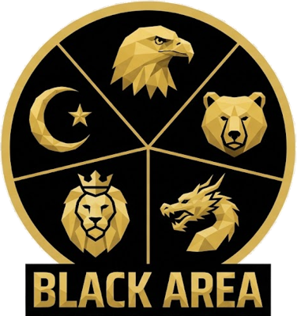
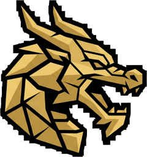
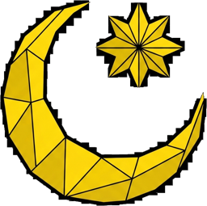

  

<h1 align="center">Black Area</h1>

Phiên bản 1.60.1

<b><a href="https://black-area.vercel.app">▶ CHƠI NGAY: black-area.vercel.app</a></b>

> **Thế giới chỉ có một. Dầu thì không đủ cho tất cả.**

*Người ta vẫn kể rằng chiến tranh không bắt đầu bằng một phát súng, mà bằng một con số trên bảng giá dầu.*

---

### I. Ngày giếng cạn

Năm 20XX, vào một buổi sáng như mọi buổi sáng, các kỹ sư ở Texas báo về Washington rằng mũi khoan đã chạm đáy. Cùng tuần đó, những tin tương tự đến từ Tây Siberia, từ sa mạc Tân Cương, từ những giàn khoan lạnh giá ngoài khơi Bắc Âu. Trái Đất đã cho đi gần hết những gì nó có.

Người ta tìm đến New York, như mọi lần thế giới gặp nạn.

### II. Ngày Liên Hợp Quốc sụp đổ

Phiên họp khẩn cấp của Hội đồng Bảo an kéo dài mười chín ngày. Washington đề xuất chia lại hạn ngạch dầu theo sức mua. Moscow phủ quyết. Bắc Kinh đề xuất chia theo dân số. Washington phủ quyết. Paris đòi một quỹ dầu chung do một ủy ban quốc tế quản lý, và lần này cả hai bên cùng phủ quyết. Riyadh không đề xuất gì. Họ chỉ nhắc rằng dầu đang nằm dưới đất của ai.

Đến ngày thứ hai mươi, những chiếc ghế bắt đầu trống. Phái đoàn này về nước "để tham vấn", rồi không quay lại. Phái đoàn khác ngừng đóng niên liễm. Lực lượng gìn giữ hòa bình bị gọi về từng đơn vị một, vì không quốc gia nào còn muốn trả tiền để lính của mình đứng giữa hai bên đang tranh giành dầu. Liên Hợp Quốc không bị ai giải tán. Nó chỉ chết dần trong im lặng: một tòa nhà bên sông East River, cờ vẫn treo, nhưng không còn ai nghe.

Lý do thật ra rất đơn giản. Trật tự cũ được dựng lên khi chỉ có vài cường quốc đủ sức áp đặt luật chơi cho phần còn lại. Giờ đây, năm quốc gia đều đủ mạnh: đủ quân để tự vệ, đủ tiền để không phải nghe ai, đủ tham vọng để tin rằng luật của mình mới là luật đúng. Không ai chịu đứng dưới ai. Và một thế giới mà ai cũng muốn làm trọng tài thì không còn chỗ cho trọng tài nào cả.

### III. Năm cực, năm bộ luật

Không ai tuyên chiến. Người ta chỉ lặng lẽ xé bỏ từng hiệp ước, rút khỏi từng liên minh cũ. Đến cuối năm, thế giới không còn một trung tâm, mà có năm.

  
  
  
  
  

**Washington** muốn một thế giới của thị trường tự do, nơi dầu thuộc về ai trả giá cao nhất. Họ đánh nhanh, đánh xa, đánh chính xác, và khi lời nói không còn tác dụng, những pháo đài bay B-52 cất cánh để xóa sổ cả một căn cứ.

**Moscow** muốn một thế giới của vùng ảnh hưởng, nơi mỗi cường quốc được tự quyết trong sân nhà mình. Họ tin vào hỏa lực áp đảo, và tiếng Tu-16 rền vang trên bầu trời phương Đông là lời nhắc rằng sân nhà ấy rộng đến đâu.

**Bắc Kinh** muốn một thế giới của trật tự và kế hoạch, nơi tài nguyên chia theo nhu cầu của những dân tộc đông người nhất. Thép của họ dày, quân của họ đông, và công xưởng của họ không bao giờ ngủ.

**Paris** muốn một thế giới của luật lệ và thể chế, dù không còn ai chịu ngồi vào bàn để viết chúng. Châu Âu cân bằng và bền bỉ, sẵn sàng cho mọi mặt trận, vì họ biết mình không thể thua ở mặt trận nào.

**Riyadh** muốn một thế giới nơi kẻ giữ dầu đặt giá, và mọi kẻ khác phải trả. Liên minh Hồi giáo ngồi trên mỏ Abu Dhabi, mỏ dầu giàu nhất còn sót lại, và nắm trong tay cartel dầu. Họ không cần súng. Chỉ một lệnh **cắt giảm**, giá dầu vọt lên trời. Chỉ một lệnh **xả kho**, ngân khố của đối thủ sụp đổ trong một đêm.

Năm bộ luật. Một hành tinh. Không bên nào chịu chơi theo luật của bên kia, nên chỉ còn một cách để biết luật nào thắng.

### IV. Kẻ đứng giữa

Ở Zürich, giữa những tòa nhà kính im lặng, Global Monitoring Center đếm tiền. Nó là người mua dầu duy nhất còn lại. Nó niêm yết một giá chung cho tất cả, cho vay khi ngân khố cạn, và luôn thu nợ trước mọi khoản tiền khác.

Giếng dầu bơm ngày đêm. Ai bán đúng lúc thì ngân khố đầy. Ai bán sai lúc thì kéo cả thị trường sụp theo. Global Monitoring Center không chọn phe. Nó chỉ kiên nhẫn chờ xem ai vỡ nợ trước.

### V. Những kẻ muốn đứng ngoài

Anh rời Liên minh châu Âu. Canada bước ra khỏi cái bóng của Washington. Cùng với Nhật Bản, Úc, Brazil và hai miền Triều Tiên, họ tuyên bố trung lập và tin rằng như vậy là an toàn.

Họ đã nhầm. Trong cuộc chiến này, trung lập chỉ có nghĩa là *chưa bị chiếm*. Thủ đô của họ không thể bị phá hủy, nhưng một kỹ sư lặng lẽ bước qua cửa 10 Downing Street hay Parliament Hill là đủ để cả một quốc gia đổi chủ. Kẻ chiếm được nhận 1200 TB mỗi hai phút tiền phí hiện diện quân sự và được dựng căn cứ ngay bên cạnh. Nhưng giữ được thì phải đóng quân canh, vì các phe khác sẽ đến giành lại.

### VI. Lục địa trắng

Rồi một ngày, vệ tinh chụp được những ngọn lửa đốt khí giữa băng tuyết Nam Cực. Dưới lớp băng, những giếng dầu vô chủ vẫn đang bơm.

Không ai được phép dựng dù chỉ một mái nhà trên lục địa ấy. Không căn cứ, không doanh trại, không đường băng. Chỉ có những kỹ sư được thả xuống từ máy bay vận tải, lội qua bão tuyết để đặt tay lên van giếng. Giếng thuộc về phe của người kỹ sư cuối cùng chạm vào nó, và dầu chảy về ngân khố phe đó như mọi giếng dầu khác. Nhưng chẳng ai giữ được lâu: luôn có một kỹ sư khác, của một phe khác, đang trên đường tới.

### VII. Luật của chiến tranh

Dầu bán lấy tiền. Tiền mua xe tăng. Xe tăng bảo vệ giếng dầu. Vòng tròn ấy cứ thế quay.

Xe tăng lăn bánh khỏi xưởng chiến tranh. Tiêm kích xé gió trên đường băng. Máy bay vận tải chở cả đội quân vượt đại dương, đổ bộ lên những vùng đất vô chủ. Những người cắm cờ biến đất hoang thành lãnh thổ, và thế giới có thêm một đồng minh của bạn. Ai tha cho kẻ địch đang rút lui còn được ngân hàng thưởng tiền cho lòng nhân từ.

Nhưng mất thủ đô và mất quân đội, quốc gia của bạn biến mất khỏi bản đồ, như chưa từng tồn tại.

### VIII. Người đứng cuối cùng

Câu chuyện này chưa có kết thúc. Nó đang chờ bạn viết nốt.

Chỉ một kẻ còn đứng cuối cùng sẽ quyết định Trái Đất còn lại những gì.

---

<b>Black Area. Cuộc chiến giành lấy Trái Đất bắt đầu.</b>

<a href="https://black-area.vercel.app"><b>▶ black-area.vercel.app</b></a>

